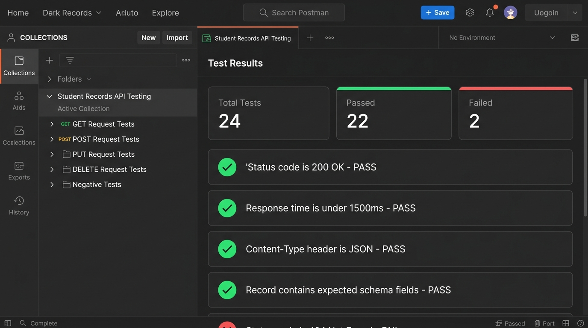

# REST API Testing and Validation Using Postman


-brightgreen)


A clean, industry-aligned REST API testing project using **Postman Free Edition**. This repository contains a complete test suite covering CRUD operations, automated JavaScript test assertions, negative testing scenarios, test cases, and defect documentation.

---

## 📌 Table of Contents
1. [Project Overview](#-project-overview)
2. [Practice API Details](#-practice-api-details)
3. [Tools Used](#-tools-used)
4. [API Endpoints Tested](#-api-endpoints-tested)
5. [Repository Structure](#-repository-structure)
6. [Test Execution & Evidence](#-test-execution--evidence)
7. [How to Import and Run the Collection](#-how-to-import-and-run-the-collection)
8. [Postman Test Assertions](#-postman-test-assertions)
9. [Defects Found & API Limitations](#-defects-found--api-limitations)

---

## 🎯 Project Overview

This project validates RESTful endpoints for student/member records using Postman. It covers:
- Standard **CRUD operations** (Create, Read, Update, Delete).
- Automated **JavaScript test assertions** (`pm.test`, `pm.expect`).
- **Negative testing** (non-existent IDs, invalid routes, malformed payloads).
- Detailed **Test Case documentation** (CSV format) and **Defect Reports**.

---

## 🌐 Practice API Details

- **API Provider:** [JSONPlaceholder](https://jsonplaceholder.typicode.com)
- **Base URL:** `https://jsonplaceholder.typicode.com`
- **Resource Mapped:** `/users` (tested conceptually as Student Records)
- **Authentication:** None required (Publicly accessible, free)

> **API Simulation Note:** JSONPlaceholder is a mock practice API. `POST`, `PUT`, and `DELETE` requests simulate realistic success responses (e.g., returning `id: 11` on POST), but do not permanently mutate remote server storage.

---

## 🛠️ Tools Used

- **Postman** (Free Edition) – API request building and test execution
- **JSON** – Data interchange format
- **JavaScript** – Postman test assertions
- **Git & GitHub** – Version control and repository hosting

---

## 📋 API Endpoints Tested

| HTTP Method | Endpoint | Description |
| :--- | :--- | :--- |
| `GET` | `/users` | Retrieve all user records |
| `GET` | `/users/:id` | Retrieve single record by ID (e.g., `/users/1`) |
| `GET` | `/users?username=Bret` | Filter records by query parameter |
| `POST` | `/users` | Create a new user record with JSON payload |
| `PUT` | `/users/:id` | Full update of existing record |
| `PATCH` | `/users/:id` | Partial update of specific fields |
| `DELETE`| `/users/:id` | Delete record by ID |
| `GET` | `/users/999` | Non-existent record validation (404) |
| `GET` | `/invalid_students` | Invalid route validation (404) |

---

## 📂 Repository Structure

```text
rest-api-testing-postman/
│
├── README.md                                             # Project documentation
│
├── postman/
│   └── student_records_api_testing.postman_collection.json # Exported Postman collection with test scripts
│
├── test-cases/
│   └── api_test_cases.csv                                # 24 detailed test cases (Excel-compatible)
│
├── bug-reports/
│   ├── defect_report_template.csv                        # Standard QA defect logging template
│   └── defects_found.csv                                 # Documented defects & mock limitations
│
├── reports/
│   └── test_execution_summary.md                         # Detailed test metrics and summary
│
└── screenshots/
    ├── README.md                                         # Screenshots index
    └── postman_collection_runner.png                     # Visual execution evidence
```

---

## 📸 Test Execution & Evidence

### Postman Collection Runner Execution


### Execution Summary Metrics
- **Total Test Cases:** 24
- **Passed:** 22 (91.7%)
- **Failed:** 2 (8.3% – due to mock API accepting empty/invalid payloads without schema errors)
- **Blocked / Not Run:** 0
- **Defects Logged:** 3

*Full report available in [reports/test_execution_summary.md](reports/test_execution_summary.md).*

---

## 🚀 How to Import and Run the Collection

1. Clone or download this repository:
   ```bash
   git clone https://github.com/Jeelanimohammad/rest-api-testing-postman.git
   ```
2. Open **Postman**.
3. Click **Import** (top left).
4. Drag and drop `postman/student_records_api_testing.postman_collection.json`.
5. Select the collection **Student Records API Testing**.
6. Click **Run** to execute all tests automatically through the Collection Runner.

---

## 💻 Postman Test Assertions

Sample assertions included in the collection:

```javascript
// 1. Verify HTTP status code
pm.test("Status code is 200 OK", function () {
    pm.response.to.have.status(200);
});

// 2. Verify response time benchmark
pm.test("Response time is under 1500ms", function () {
    pm.expect(pm.response.responseTime).to.be.below(1500);
});

// 3. Verify JSON Content-Type header
pm.test("Content-Type header is JSON", function () {
    pm.expect(pm.response.headers.get("Content-Type")).to.include("application/json");
});

// 4. Verify response schema and data types
pm.test("Record contains valid fields", function () {
    const jsonData = pm.response.json();
    pm.expect(jsonData.id).to.eql(1);
    pm.expect(jsonData.name).to.be.a("string");
    pm.expect(jsonData).to.have.property("email");
});
```

---

## 🐛 Defects Found & API Limitations

| Bug ID | Endpoint | Method | Observed Behavior | Expected Production Behavior | Severity |
| :--- | :--- | :--- | :--- | :--- | :--- |
| **BUG-API-01** | `/users` | POST | Submitting empty JSON `{}` returned `201 Created` | Return `400 Bad Request` indicating missing required fields | Medium |
| **BUG-API-02** | `/users` | POST | Submitting invalid email string returned `201 Created` | Return `400 Bad Request` indicating invalid email format | Low |
| **BUG-API-03** | `/users` | POST | Malformed JSON caused `500 Internal Server Error` | Return `400 Bad Request` for client syntax errors | Medium |

---

## 👤 Author
**Mohammad Jeelani**  
- GitHub: [@Jeelanimohammad](https://github.com/Jeelanimohammad)  
- Repository: [rest-api-testing-postman](https://github.com/Jeelanimohammad/rest-api-testing-postman)